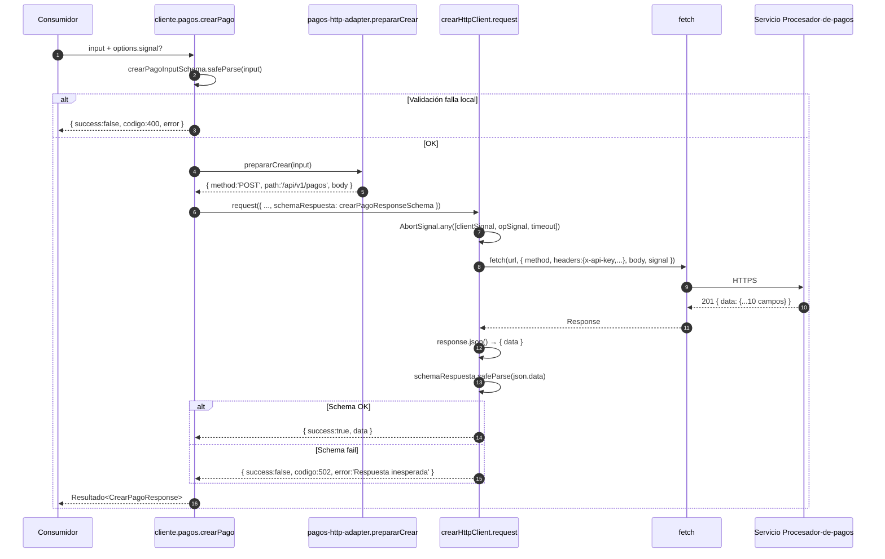
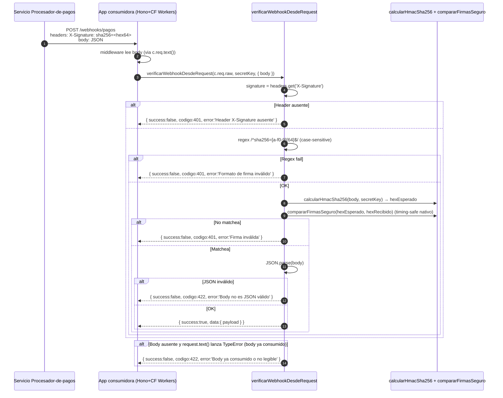

# Arquitectura — `@eva/procesador-pagos-sdk`

> Servicio testeado: commit `380874771a21b56bd42f1db23c60627c62209327`.

## 1. Modelo

SDK **backend-to-backend** + **Edge** (no browser). El consumidor es un servicio Node, un Worker Cloudflare, una función Vercel Edge — cualquier runtime que pueda mantener una `apiKey` secreta.

El SDK NO maneja:

- Pagos del lado cliente (browser → no, expone apiKey).
- Retry policy interna (delegado al consumidor — ADR-006).
- Logging (delegado al consumidor).
- Observabilidad (sin OpenTelemetry, sin events).

El SDK SÍ maneja:

- Construir la URL correcta en build-time (ADR-001).
- Mapear errores HTTP al `Resultado<T>` (ADR-002).
- Cancelación cooperativa (triple `AbortSignal` con `AbortSignal.any` — I5).
- Verificación HMAC-SHA256 timing-safe (ADR-004).
- Sanitizar la `apiKey` para que NUNCA aparezca en mensajes de error.

## 2. Capas (Feature-based + Clean + Screaming)

```
src/
├── core/                      # Cross-cutting (no Pagos-specific)
│   ├── cliente/               # Factory funcional `crearCliente`
│   ├── config.ts              # __SDK_API_URL__ + check defensivo C5
│   ├── errors/                # AppError + helpers tipados
│   ├── http-client/           # Factory http + mapeo de errores HTTP
│   └── types/                 # Resultado<T> + CodigoErrorHttp + helpers narrow
├── features/
│   ├── pagos/
│   │   ├── domain/            # tipos-pago, schemas Zod (mirror del servicio)
│   │   ├── infrastructure/    # pagos-http-adapter (puro, sin red)
│   │   └── application/       # 6 ops: crear, consultar, listar, iterar, cancelar, reembolsar
│   └── webhooks/
│       ├── domain/            # webhook-types + REGEX_FIRMA_WEBHOOK
│       ├── infrastructure/    # comparar-firmas-seguro, calcular-hmac-sha256
│       └── application/       # verificarFirmaWebhook + verificarWebhookDesdeRequest
├── index.ts                   # Entry: cliente + types públicos
└── webhooks.ts                # Subpath entry: solo verificación de webhooks
```

### Por qué Feature-based + Clean + Screaming

- **Feature-based**: la unidad de cambio es una "feature" (`pagos`, `webhooks`). Agregar un feature nuevo (e.g. `tokenizacion`) no toca `core/` ni `pagos/`.
- **Clean Architecture**: cada feature divide en `domain` (tipos puros), `infrastructure` (primitivas runtime-aware o sustituibles), `application` (la lógica de negocio que ensambla domain+infra). Las dependencias siempre apuntan hacia adentro: `application` → `infrastructure` → `domain`. Nunca al revés.
- **Screaming**: al ver `src/features/pagos/application/` el código *grita* "esto es lógica de pagos". No "controllers". No "services".

### Cuándo se usa `infrastructure/`

Regla práctica: **solo si la primitiva es sustituible o runtime-aware**.

- `comparar-firmas-seguro` → `infrastructure/` porque feature-detecta `crypto.subtle.timingSafeEqual` vs `node:crypto.timingSafeEqual` según runtime.
- `pagos-http-adapter` → `infrastructure/` porque traduce inputs de dominio a `{ method, path, body, query }` (request shape, no negocio).
- Schemas Zod, types puros → `domain/`.
- Las funciones de aplicación (`crearPago`, `consultarPago`, …) → `application/`.

### Acceso cross-feature

Solo vía **facade pública** del feature (`features/pagos/index.ts`, `features/webhooks/index.ts`). Nunca importar desde `application/` ni `infrastructure/` de otro feature.

El barrel principal `src/index.ts` re-exporta el contrato público (cliente + types). Schemas Zod NO se exportan al consumidor — son detalle interno.

## 3. Cliente como factory funcional con namespace agrupado

`crearCliente()` es una factory funcional (zero classes) que retorna un objeto con namespace agrupado:

```typescript
const cliente = crearCliente({ apiKey: '…' });

cliente.pagos.crearPago(…);
cliente.pagos.consultarPago(…);
cliente.pagos.iterarPagos(…);
// cliente.tokens.crear(…)        // futuro feature
// cliente.subscripciones.crear(…) // futuro feature
```

Decisión UX-1 / ADR-003: el namespace agrupado escala mejor que un cliente plano (`cliente.crearPago`, `cliente.consultarPago`, …) cuando se agreguen 2+ features.

## 4. Result Pattern como contrato público

```typescript
type Resultado<T> =
  | { success: true; data: T }
  | { success: false; error: string; codigo: 400|401|403|404|409|413|422|500|502|503 }
  | { success: false; error: string; codigo: 429; retryAfter?: number };
```

Beneficios:

- TS strict obliga a discriminar antes de acceder a `.data` (no `try/catch` olvidados).
- `codigo` es union cerrado → `switch` exhaustivo.
- `retryAfter` solo accesible cuando `codigo === 429` (TS error si se accede en otra variante).

Excepción justificada: `iterarPagos` lanza `Error` con `cause: Resultado` (ver ADR-005).

## 5. Build-per-environment

```
EVA_PAGOS_BUILD_ENV ∈ { local, development, production }
        │
        ▼
tsdown define __SDK_API_URL__ + __SDK_BUILD_ENV__
        │
        ▼
dist/index.{js,cjs,d.ts} con URL inlined como string literal
```

La URL del servicio NO se pasa al constructor del cliente. El consumidor instala una versión específica del SDK que ya sabe contra qué entorno habla.

Defensa runtime adicional (ADR-007 / C5): si el bundle se mezcla (URL local pero env=production), `core/config.ts` lanza al cargar.

## 6. Runtime support

| Runtime | Soporte | Nota |
|---|---|---|
| Node 18+ | Sí | `fetch`, `AbortSignal.any`, `AbortSignal.timeout`, `crypto.subtle` nativos desde Node 18+. |
| Cloudflare Workers | Sí | Requiere flag `nodejs_compat` para soportar `node:crypto` fallback (rara vez se ejecuta — `subtle.timingSafeEqual` está disponible en Workers). |
| Vercel Edge Runtime | Sí | `subtle.timingSafeEqual` disponible. |
| Browser | No | apiKey es secreta. El SDK no se hornea para browser (sin minify de single-file UMD). |

## 7. Flujo HTTP típico (crearPago)



## 8. Flujo de webhook



## 9. Decisiones clave (resumen)

| ADR | Decisión |
|---|---|
| ADR-001 | URL del servicio horneada en build-time (no overridable). |
| ADR-002 | Result Pattern como contrato público. |
| ADR-003 | Namespace agrupado `cliente.pagos.X`. |
| ADR-004 | `compararFirmasSeguro` con primitivas nativas (fail-closed). |
| ADR-005 | `iterarPagos` yields `PagoResumen` directo + throws `Error(msg, { cause: Resultado })`. |
| ADR-006 | Overrides `fetch`/`timeout`/`headers`/`signal`; URL nunca. |
| ADR-007 | Defensa runtime contra build mismatch (síncrona al cargar). |
| ADR-008 | Migración de `tsup` a `tsdown`. |

Detalles completos en `docs/decisions.md`.
